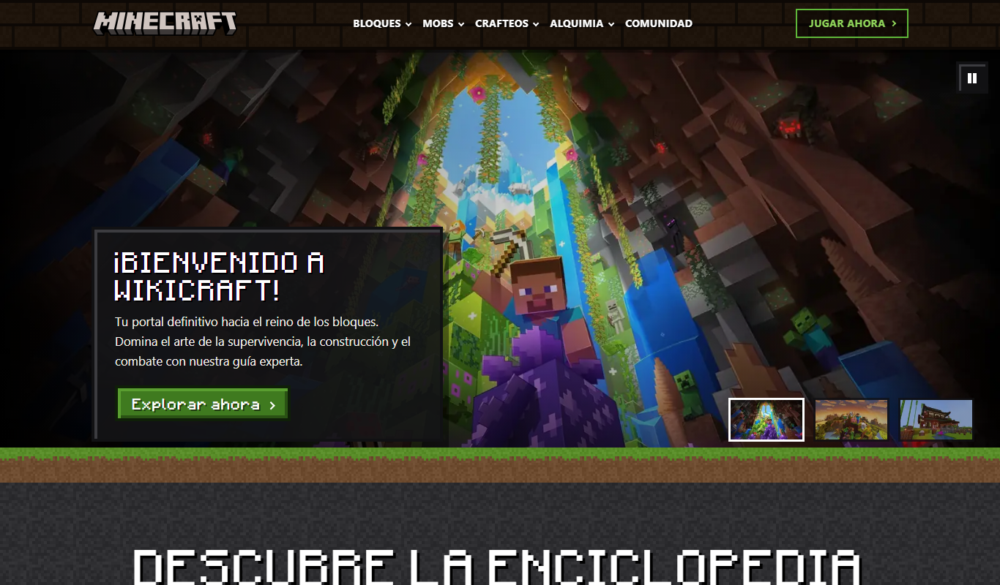
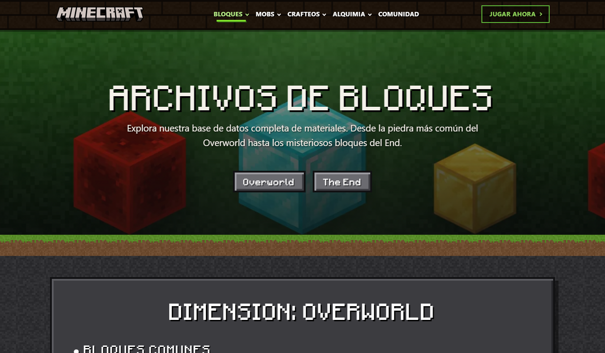
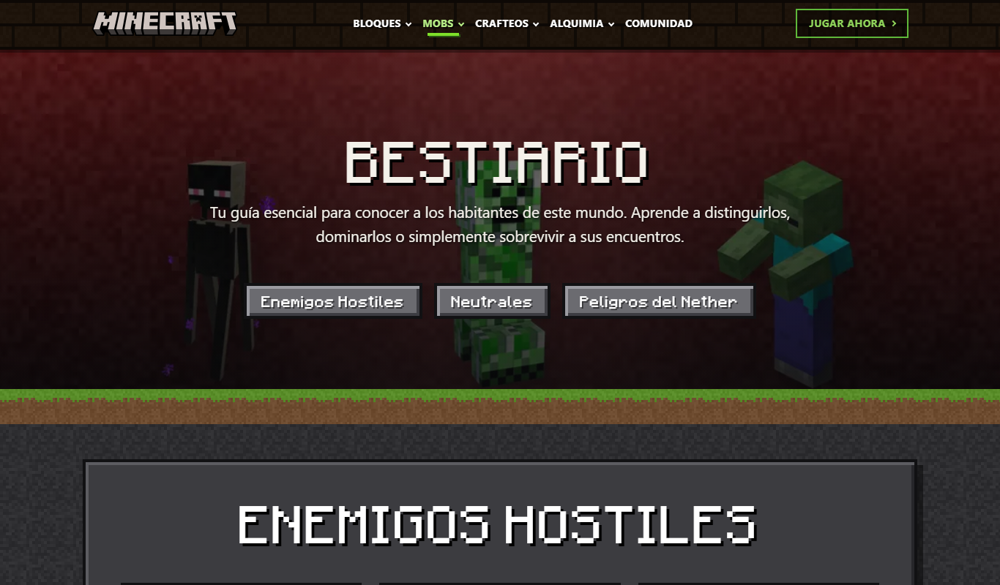
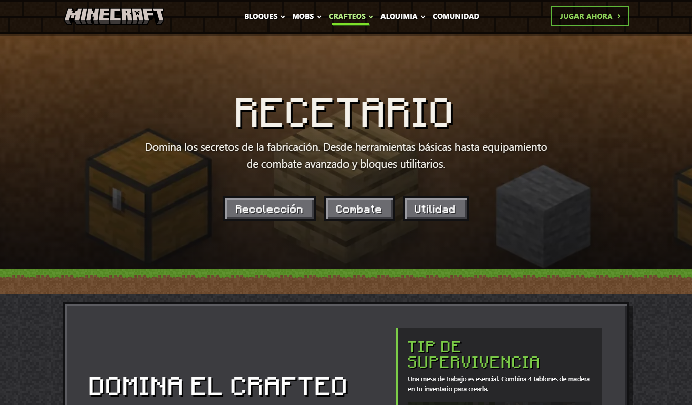
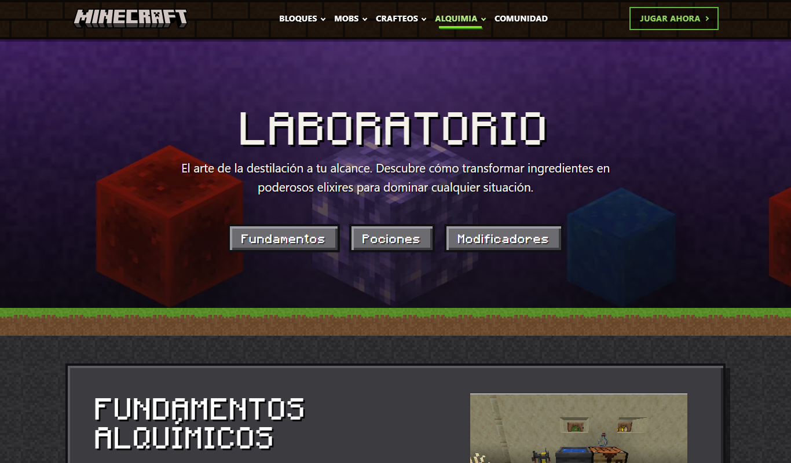
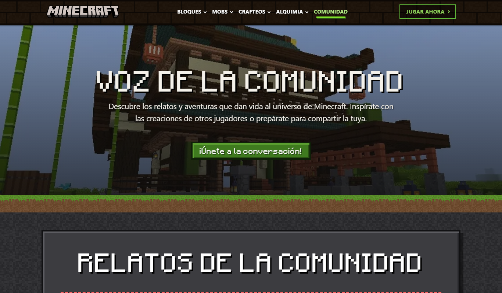
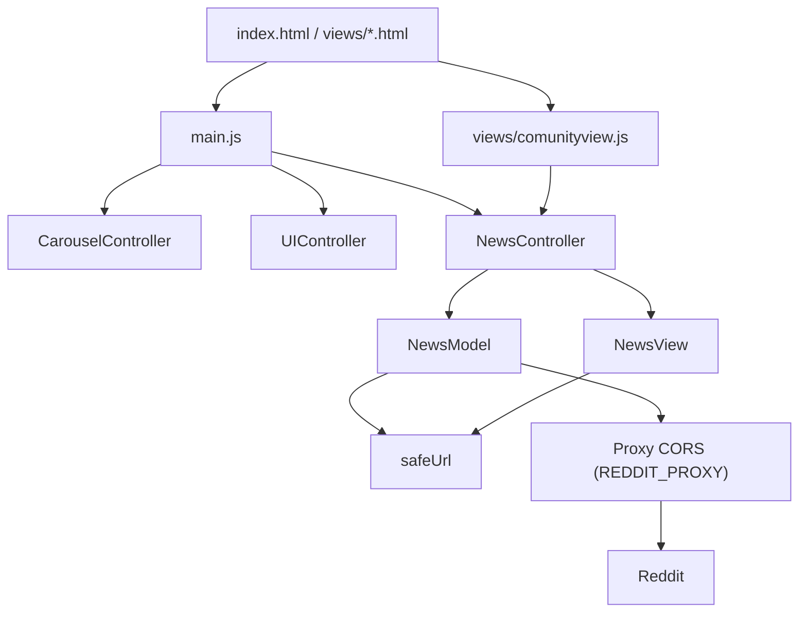

# 💎 WikiCraft — La Enciclopedia Definitiva de Minecraft

[](https://getbootstrap.com/)
[](https://developer.mozilla.org/es/docs/Web/JavaScript)
[](https://developer.mozilla.org/es/docs/Web/HTML)
[](https://nodejs.org/)
[](LICENSE)
[](https://kiramman-mp3.github.io/WikiCraft/)

**WikiCraft** es una enciclopedia web de Minecraft para jugadores que buscan información rápida sobre bloques, mobs, crafteos y pociones, con una estética fiel al juego. Es un sitio estático: HTML, CSS y JavaScript sin backend ni base de datos.

Es un proyecto académico sin fines de lucro: WikiCraft no incluye publicidad propia, donaciones ni ninguna otra forma de monetización. No está afiliado a Mojang Studios ni a Microsoft. La estructura de la portada se inspira en la organización de minecraft.net; el arte, los textos y el estilo son propios.

> [!TIP]
> Para verlo funcionando visita la **[versión en vivo](https://kiramman-mp3.github.io/WikiCraft/)** o, en local, ejecuta `npm start` y abre `http://localhost:8080`.

---

## 📖 Descripción

### ¿Qué problema resuelve?

La información de Minecraft está dispersa y suele ser larga o difícil de recorrer. WikiCraft la reúne en siete páginas cortas, navegables y con un diseño coherente.

### ¿Qué hace?

1. Muestra una portada con carrusel, tarjetas de sección, bloques destacados y un selector por pestañas.
2. Ofrece una página por tema: bloques, mobs, crafteos, alquimia, comunidad y un juego en el navegador.
3. Carga noticias de Reddit (`r/minecraft` y `r/minecraftespanol`) a través de un proxy CORS.
4. Si las noticias no cargan, muestra un estado de error con botón de reintento.

### ¿Para quién está pensado?

Para jugadores de Minecraft que quieren consultar datos rápidos, y para el grupo de desarrollo como práctica de HTML, CSS y JavaScript modular.

---

## 📸 Capturas

| Inicio | Bloques | Mobs |
| :---: | :---: | :---: |
| <br><sub>Portada con carrusel</sub> | <br><sub>Bloques</sub> | <br><sub>Bestiario</sub> |

| Crafteos | Alquimia | Comunidad |
| :---: | :---: | :---: |
| <br><sub>Crafteos</sub> | <br><sub>Alquimia</sub> | <br><sub>Voz de la comunidad</sub> |

---

## ✨ Características

- **Bloques**: materiales del Overworld y del End con su uso y dónde encontrarlos.
- **Mobs**: criaturas hostiles, neutrales y peligros del Nether.
- **Crafteos**: recetas de herramientas, equipo de combate y bloques de utilidad.
- **Alquimia**: fundamentos, efectos y modificadores de pociones.
- **Comunidad**: relatos de la comunidad y publicaciones recientes de Reddit.
- **Jugar**: Minecraft jugable en el navegador (Eaglercraft) incrustado desde un sitio externo.
- **Diseño Minecraft propio**: fondo de piedra, barra de tablones, bordes con bisel y texturas de 16x16.
- **Carrusel accesible**: botón de pausa y sin autoplay si el usuario prefiere menos movimiento.
- **Seguridad del cliente**: Content Security Policy, URLs `https` validadas y enlaces externos con `rel="noopener noreferrer"`.

---

## 🛠️ Tecnologías Utilizadas

- **Frontend**: HTML5, CSS3 (`css/styles.css` y `css/home.css`), JavaScript con ES modules, Bootstrap 5.3.5 servido localmente desde `assets/dist/`.
- **Backend**: ninguno. Las noticias se piden a Reddit mediante un proxy CORS externo.
- **Base de datos**: ninguna.
- **Pruebas**: `node:test` y un verificador estático propio (`scripts/check-site.mjs`).
- **Herramientas**: Python 3 (servidor local y `scripts/generate-art.py` con Pillow) y Node.js.
- **Despliegue**: GitHub Pages.

---

## 🏗️ Arquitectura



Cada página carga `main.js`, que inicia el carrusel, el botón de subir y las noticias. Las noticias siguen un patrón modelo, vista y controlador: el modelo pide y limpia los datos, la vista construye el DOM con `textContent` y el controlador gestiona los estados de carga, error y vacío.

---

## 🗂️ Estructura del Proyecto

```bash
index.html            # Inicio
views/                # Páginas (bloques, mobs, crafteos, alquimia, comunidad, jugar) y vistas JS
controllers/          # NewsController (carga y estados), CarouselController (carrusel) y UIController (botón de subir)
models/               # NewsModel (Reddit) y safeUrl (validador de URLs https)
main.js               # Punto de entrada común a todas las páginas
css/styles.css        # Sistema de diseño Minecraft (cabecera, pie, componentes)
css/home.css          # Estilos exclusivos de la portada
assets/dist/          # Bootstrap local
images/textures/      # Texturas pixeladas de 16x16 usadas por el CSS
images/art/           # Ilustraciones generadas (tarjetas, banners, diapositivas)
docs/capturas/        # Capturas de pantalla usadas en este README
tests/                # Pruebas con node:test
scripts/              # check-site.mjs (verificador estático) y generate-art.py (regenera images/art/)
AUDITORIA_Y_MEJORAS.md # Informe de auditoría y mejoras
CONTRIBUTING.md       # Guía para contribuir
LICENSE               # Licencia MIT
```

---

## 📋 Requisitos del Sistema

- **Python 3**: para `npm start`. Sirve cualquier otro servidor estático.
- **Node.js 20 o superior**: para `npm test`, `npm run check` y `npm run verify`.
- **Pillow** (`pip install pillow`): solo para regenerar `images/art/` con `scripts/generate-art.py`.
- **Navegador moderno**: las animaciones por scroll son una mejora progresiva.
- **Producción**: solo un hosting estático con HTTPS.

---

## ⚙️ Instalación y Configuración

1. Clona el repositorio:
   ```bash
   git clone https://github.com/kiramman-mp3/WikiCraft.git
   ```
2. Entra al directorio:
   ```bash
   cd WikiCraft
   ```
3. Inicia un servidor estático. Los módulos ES no funcionan abriendo `index.html` con `file://`:
   ```bash
   npm start
   ```
4. Abre `http://localhost:8080`.

No hay variables de entorno ni `npm install` obligatorio: Bootstrap ya está en `assets/dist/`. La URL del proxy está en la constante `REDDIT_PROXY` de `models/NewsModel.js`. Si usas un proxy con clave, nunca la guardes en el repositorio.

---

## ▶️ Uso y Ejecución

### Desarrollo local

```bash
npm start
```

### Verificación antes de integrar

```bash
npm run verify
```

| Comando | Qué hace |
| :--- | :--- |
| `npm start` | Sirve el sitio en `http://localhost:8080` |
| `npm test` | Pruebas del modelo de noticias (`tests/`) |
| `npm run check` | Verifica enlaces locales, `alt`, ids, anclas, CSP, navegación y estructura de las 7 páginas |
| `npm run verify` | Ejecuta `check` y `test` |
| `python scripts/generate-art.py` | Regenera las ilustraciones de `images/art/` (requiere Pillow) |

---

## 🚀 Despliegue

El sitio se publica en [GitHub Pages](https://kiramman-mp3.github.io/WikiCraft/). No hay paso de build ni variables que definir en la plataforma. Los cambios llegan a `main` solo por integración desde `develop`.

---

## 🔍 Detalles Técnicos

### Noticias y proxy de Reddit

Las noticias y la comunidad dependen de un proxy CORS configurado en `REDDIT_PROXY` (`models/NewsModel.js`). El proxy actual (`corsproxy.io`) responde `403 keyless_legacy_url` porque exige API key, así que hoy esas secciones muestran el estado de error con botón de reintento. La solución pendiente es usar un proxy propio y ajustar la CSP.

### Seguridad

| Medida | Dónde |
| :--- | :--- |
| Content Security Policy sin `unsafe-inline` | `<meta>` de cada página |
| Sin atributos `style=` en línea | Verificado por `npm run check` |
| Solo URLs `https` en imágenes y enlaces de noticias | `models/safeUrl.js` |
| DOM construido con `textContent` | `views/NewsView.js` |
| `rel="noopener noreferrer"` en enlaces externos | Todas las páginas |

### Diseño y accesibilidad

- Tokens de color y bisel en `css/styles.css`; fuente pixelada solo en títulos y botones.
- Contraste WCAG AA en textos y botones, foco visible y `prefers-reduced-motion` respetado.
- Sin desbordamiento horizontal en las 7 páginas a 375, 430, 768, 1366 y 1920 px.

### Informe de auditoría

El detalle de problemas, mejoras y pendientes está en `AUDITORIA_Y_MEJORAS.md`.

---

## 👥 Contribuidores

Número de commits según `git shortlog -sn`. Los commits de `kiramman-mp3`, `Kiramman-mp3` y `Johan Kiramman` se suman porque son la misma persona, y `IngePablito` y `Aleduss07` figuran con su nombre real.

| Contribuidor | Commits |
| :--- | :---: |
| kiramman-mp3 | 102 |
| Pablo Vayas | 24 |
| Alexis López | 13 |
| José Manzano | 10 |
| Alan Cuenca | 5 |

Para colaborar, lee `CONTRIBUTING.md`: crea una rama `feature/*` o `fix/*` desde `develop` y abre un Pull Request.

<details>
<summary>📚 Fuentes y referencias</summary>

- [Bootstrap 5.3](https://getbootstrap.com/docs/5.3/)
- [minecraft.net](https://www.minecraft.net/es-es): referencia de la organización de la portada.
- [r/minecraft](https://www.reddit.com/r/minecraft/) y [r/minecraftespanol](https://www.reddit.com/r/minecraftespanol/): origen de las noticias.
- [minecraftforfreex.com](https://minecraftforfreex.com): juego incrustado en la página Jugar.

</details>

---

## 📄 Licencia

El código y el diseño de WikiCraft se distribuyen bajo la licencia MIT. Consulta el archivo [LICENSE](LICENSE). WikiCraft es un proyecto académico sin fines de lucro. El nombre Minecraft y sus texturas o capturas pertenecen a Mojang AB y no están cubiertos por esa licencia.

---

## 🧑‍💻 Autor

**kiramman-mp3**
